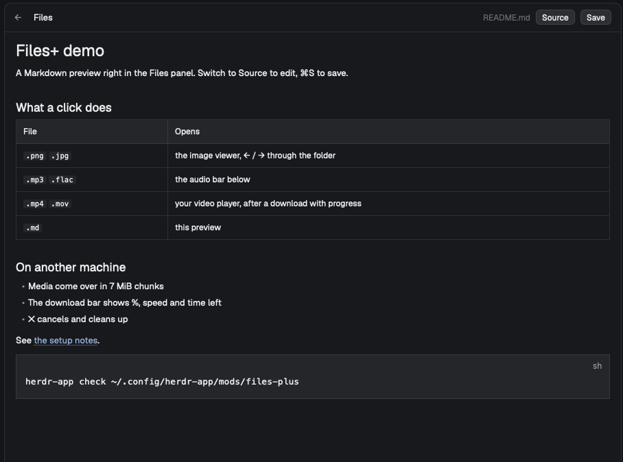

# herdr-files-plus

**Files+** for the Herdr app: the built-in Files panel, extended. It works the same on this computer
and on another machine (a space opened over `hc`): images open in a viewer with ← / →, audio plays
in a bar at the bottom of the panel, videos open in your player with a download progress bar,
Markdown opens as a rendered preview with its images and Mermaid / BPMN diagrams, a PDF shows its first page, files of another machine download to `~/Downloads`, files
dropped from Finder upload, and right-click lets you rename, create and move to the Trash.
See [files-plus/RECIPE.md](files-plus/RECIPE.md) for how it is built.



## What it adds to the built-in Files panel

- **Images**: a click opens the `image-viewer-plus` dialog (Fit, 100 %, zoom, ← / → through the
  folder's images), also for images on another machine (up to 64 MB).
- **Audio** (mp3, flac, wav, m4a, ogg, …): plays in a bar at the bottom of the panel with
  play/pause, −10 s / +10 s and a seekable progress bar (`ffplay`, no window).
- **Video** (mp4, mov, mkv, webm, …): opens in the system player, or in an `ffplay` window when no
  app takes the format.
- **HTML**: opens in the default browser; right-click → Edit for the source.
- **Markdown**: a rendered preview, with a **Source / Preview** toggle; relative links open that
  file in the panel, web links in the browser. Local images (``, ``)
  show at the panel's width, also from another machine (up to 25 MB each, 40 per file); a click
  opens one in the viewer. Images from the web show as their alt text.
- **Big window**: ⤢ in the panel's header opens the shown Markdown, diagram or PDF in a dialog over
  the whole window (Esc or ✕ closes it), the text in a 900 px column at 15 px. Links open in it, ←
  goes back; read-only (edit in the panel).
- **Diagrams in Markdown**: ```` ```mermaid ```` and ```` ```bpmn ```` blocks (BPMN 2.0 XML with its
  diagram section) show as pictures, in the theme's light or dark style; a click opens one in the
  viewer to zoom. A broken block shows the error and its source. Files of their own (`.bpmn`,
  `.mmd`, `.mermaid`) open as the diagram too, with **Source** for the text. Needs Node.js and Google Chrome
  (or Chromium); mermaid and the bpmn-js viewer are downloaded once from jsDelivr (pinned versions,
  SHA-256 checked) into `data/files-plus-diagrams/`.
- **PDF**: the first page, rendered here (macOS Quick Look, `pdftoppm` on Linux), with the page
  count and **Open** for the whole document in your PDF app.
- **Another machine**: media are copied here first in 7 MiB chunks, 6 at once (`hc exec` keeps only the first
  8 MB of a program's output), with a download bar showing %, MB, speed and time left, and ✕ to
  cancel. Copies live in `data/files-plus-media/` and are swept after a day.
- **Download**: right-click a file of another machine → Download saves it to `~/Downloads`
  (`name (1).ext` when the name is taken).
- **Upload**: drop files from Finder on the panel (the root), on a folder (into it) or on a file
  (beside it). On another machine they go over in 7 MiB chunks, 6 at once; here they are copied (folders
  too). Nothing is overwritten. Transfers run one at a time, the bar shows `↓` / `↑` and how many
  wait.
- **Size and date**: each row shows a file's size and when it last changed (`12 KB · 13 Nov`; today
  just the time, earlier years with the year), a folder its date; hover for the exact bytes and time.
  One `stat` per folder, also on another machine.
- **Several at once**: ⌘-click (Ctrl-click) adds or removes an entry, Shift-click takes the range;
  a bar above the tree offers **Copy**, **Move**, **Download** (files of another machine), **Copy
  path** and **Move to Trash** (asks first). After Copy / Move, right-click a folder → **Paste
  here** (or **Paste into <top folder>** in the bar); it works within one machine, and nothing is
  overwritten. The selection is kept per tab.
- **Right-click** a file or folder (or the empty area, or **+**): Download, Rename, New file, New folder,
  Move to Trash (macOS `trash`, `gio trash` or `trash-cli` on Linux).
- **Editing**: text files up to 1 MiB are editable and saved with ⌘S / Ctrl+S, also on another
  machine; a save is refused when the file changed on disk since it was opened.

## Installation

Ask your agent to add this mod (it reads every file first), or do it by hand:

1. Copy `files-plus/mods/files-plus` and `files-plus/mods/image-viewer-plus` into
   `~/.config/herdr-app/mods/`.
2. Use it in your layout. Herdr's own layouts are read-only, so clone `main` first if you haven't:
   ```sh
   herdr-app do layout.clone '{"name":"main","as":"main-plus"}'
   ```
   In `~/.config/herdr-app/layouts/main-plus.json`, change the Files panel block
   (`"id": "files"`) from `"mod": "files"` to `"mod": "files-plus"`, then:
   ```sh
   herdr-app do layout.switch --name main-plus
   ```
3. Check both mods:
   ```sh
   herdr-app check ~/.config/herdr-app/mods/files-plus
   herdr-app check ~/.config/herdr-app/mods/image-viewer-plus
   ```

**What it runs:** like the built-in Files panel, it runs programs through `exec` (`sh`, `git`,
`stat`), on another machine too. On top of that it runs `hc exec` to copy files to and from another
machine, `open` (macOS) for videos, HTML and PDFs, `qlmanage` / `pdftoppm` and `sips` / `file` for
previews, `ffplay` / `ffprobe` for audio (`brew install ffmpeg`), `node` with headless Chrome for diagrams,
and `trash` / `gio` / `trash-put` for Move to Trash. It writes only in `data/files-plus-media/`,
`data/files-plus-diagrams/` and `data/image-viewer-plus/` of the app folder and in `~/Downloads`, plus the files you edit,
create, rename, upload or trash.

## Credits

Built on the `files` and `image-viewer` mods shipped with the Herdr app (0.1.13), Apache License
2.0. See [NOTICE](NOTICE) for what was changed.

Diagrams are drawn with [mermaid](https://mermaid.js.org) (MIT) and
[bpmn-js](https://bpmn.io) (bpmn.io license), downloaded at first use, not part of this repository.

## License

[Apache License 2.0](LICENSE).
