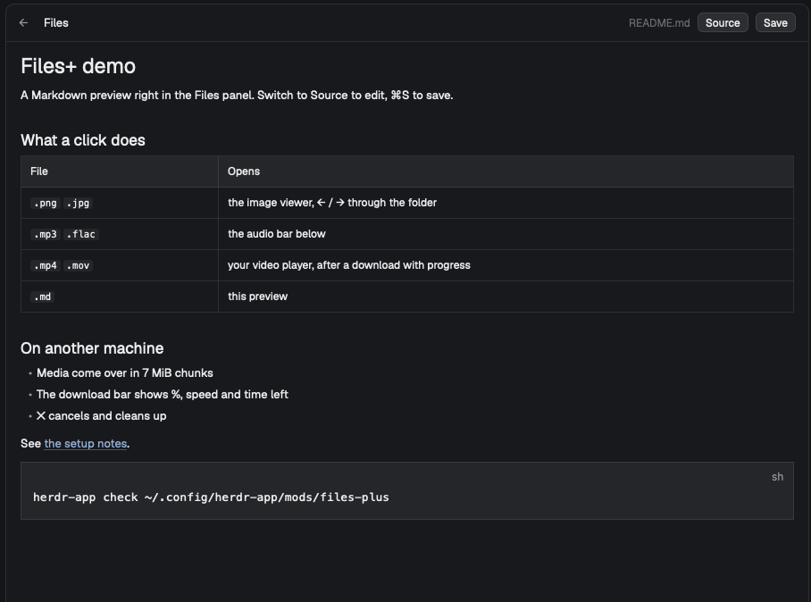

# Files+

The Files panel on the right of the window, extended so that every kind of file does something
useful on a click, here or on another machine: images open in a viewer dialog, audio plays in a
bar at the bottom of the panel, videos and HTML open in their apps after a download with a progress
bar, Markdown shows rendered, and other text files open in an editor you can save from. A
right-click renames, creates and moves to the Trash.

## What you see

Two mods: `files-plus` (the panel) and `image-viewer-plus` (a dialog it opens). Both use the
theme's colors only (`t.background`, `t.border`, `t.surface`, `t.accent`, `t.dim`, …) and the
UI font at 13px.

**The panel** (`files-plus`), a rounded (10px) column with a 1px `t.border` border:

1. **Header**, 42px, bottom border. In the tree: `Files` (semibold), the folder's name right
   aligned in `t.dim` 12px, and `+` (opens the menu for the root). With a file open: `←` first,
   then `Files`, the file's path, a `●` in `t.blocked` when there are unsaved edits, and buttons:
   `Source` / `Preview` (Markdown only), `Save` (primary while dirty, `Saving…` while saving), or
   `read-only` in 11px `t.dim` when the file can't be saved.
2. **Body**, one of:
   - **The tree**: rows 28px, 8px left padding plus 18px per level, a 12px chevron (folders), a
     14px folder or file icon in `t.muted`, the name (truncated), and a git mark on the right
     (`A` in `t.ansi2`, `D` / `U` in `t.ansi1`, `M` in `t.blocked`). The right-clicked row is
     `t.selected`. Under it, a **menu row** of 22px buttons: `Edit` (HTML only), `Rename`,
     `New file`, `New folder`, `Move to Trash` (danger, `t.ansi1`), `✕`. A Trash confirmation row
     reads `Move "name" to the Trash?` with `Move` and `Cancel`. Rename and create put an inline
     input (24px, `t.accent` border) in place of / under the row. At the end, `Loading files…`,
     `No files` or the error, and `File list limited to 500 entries per folder and 5,000 total`.
   - **A text file**: a code editor (12px, the terminal font, syntax colors from the ANSI palette),
     with an `Unsaved changes` row (`Save` / `Discard` / `Cancel`) when leaving with edits, and a
     status row (`Saved`, or the error in `t.ansi1` with `Reload from disk`).
   - **A Markdown file**: the rendered document, scrollable, 16px side and 12px vertical padding,
     selectable text.
3. **Download bar** (while a file is copied from another machine), `t.surface` with a top border:
   `↓`, the file name, `42 % · 120 MB / 286 MB · 38 MB/s · 0:04 left` in 11px `t.dim` (or
   `Preparing…`), a `✕` button, and under it a 6px `t.border` track with a `t.accent` fill.
4. **Audio bar** (while a track is loaded), same style: `▶` / `❚❚` (primary), `−10s`, `+10s`, the
   track name, `1:23 / 4:56` (or `Copying 45 % of 12 MB`), `✕`, and a 6px progress bar: `t.dim`
   fill while copying, `t.accent` while playing.

**The image dialog** (`image-viewer-plus`, a dialog 920px wide, 85 % high, `t.canvas`): a 42px bar
with `Image`, `‹ 3 / 12 ›` when there are several, `name · machine · 1920×1080 · 2.4 MB`, and
buttons `Fit`, `100%`, `−`, the zoom in %, `+`, `↻` (24px, `t.accent` when active). Below it the
image fitted (never above 100 %) or zoomed with scrollbars, or `Loading image…` / the error in
`t.ansi1`.

## How it behaves

The panel follows the focused pane's folder (`pane.cwd`, else the focused terminal's `cwd`, else
the space's folder). A terminal of another machine, or a space on another machine, makes every
action run there (`on`). The tree reloads every 10 s and on folder changes (local only), and
remembers open folders and the open file (with unsaved edits) per location.

A click on:
- **a folder** opens or closes it (lazy: its entries load on first open).
- **an image** (`png jpg gif webp bmp svg ico tif`) opens the image dialog with the folder's images
  in list order as `files`; ← / → (keys or `‹ ›`) step through them, wrapping.
- **audio** (`mp3 m4a aac wav aif flac ogg oga opus caf alac wma`) loads it in the audio bar and
  plays it. Pause, seek (±10 s or a click on the bar) restart `ffplay` at the position. Once a
  second the panel checks whether the player is still running and notices the end.
- **video** (`mp4 m4v mov mkv webm avi wmv flv mpg mpeg 3gp ts`) opens it with `open`, or in an
  `ffplay` window when that fails.
- **HTML** opens it in the default browser (copied alone: relative CSS and images don't come).
- **Markdown** (`md markdown mdown mkd`) opens it in Preview. `Source` shows the editor; edits
  show in the preview before saving. Links: `http(s):` and `mailto:` open with `open`; relative
  links resolve from the file's folder and open that file in the panel (images in the dialog).
- **anything else** opens it as text. A file with a NUL byte says `Binary file · no text preview`.

Files on another machine are copied to `data/files-plus-media/<hash>-<name>` before playing or
opening (up to 4 GB; images up to 64 MB to `data/image-viewer-plus/`). A copy with the right size
is reused. During the copy the download bar (or the audio bar) shows progress; `✕` cancels after
the chunk in flight and deletes the partial file. Opening another video or HTML file cancels the
running download. Copies older than a day are deleted when the panel starts.

Editing: the editor is writable only when the whole file was read (≤ 1 MiB, ≤ 400,000 chars).
⌘S / Ctrl+S or `Save` writes it. Here through `writeTextFile` (refuses a stale file); on another
machine as base64 chunks through `sh`, refusing when the file's `mtime:size` changed. Leaving a
dirty file (`←`, another location) asks first.

Right-click a row, the empty tree, or `+`: Rename (selects the name without the extension), New
file, New folder (inside a folder, or beside a file), Move to Trash (`/usr/bin/trash` on macOS,
`gio trash` or `trash-put` on Linux). None of them overwrite; Escape closes the input.

## Built from

- `mods/files-plus/main.js`: the panel, a `View` class `Files`. Clone of the shipped `files` mod
  (0.1.13). Uses `spaces()`, `panes()`, `focused()` for the location; `exec(…, { on })` for listing
  (a `sh` loop printing `d|f\0name\0`, max 501), git status (`--no-optional-locks`,
  `core.fsmonitor=false`), `stat`, file operations; `readTextFile`, `writeTextFile`,
  `watchFolder`, `theme()`, `settings()`, `window()`, `openOverlay({ mod: "image-viewer-plus",
  kind: "dialog", width: 920, height: 0.85, props: { file, fileOn, files } })`. From `gpui-base`:
  `Editor`, `EditorState`, `InputState`, `Input`, `TextView.markdown(id, text)`.
- `mods/files-plus/media.js`: `localCopy` (the chunked copy), `openVideo`, `openInBrowser`,
  `Player` (the audio bar), `newDownload` / `downloadView` (the download bar), `sweepCache`.
- `mods/image-viewer-plus/main.js`: clone of the shipped `image-viewer`. Stages the image into the
  app folder (`image()` only loads paths there), reads its pixel size with `sips` (macOS) or
  `file` (Linux) or `System.Drawing` (Windows), deletes the copy on close.
- Programs: `sh`, `git`, `stat`, `hc exec --on <machine> -- dd`, `open`, `ffplay`, `ffprobe`,
  `kill`, `find`, `trash` / `gio` / `trash-put`, `sips` / `file`.
- Icons: `chevron-down.svg`, `chevron-right.svg`, `file.svg`, `folder.svg` (14px / 12px, `svg()`).
- The layout: the `files` block of a cloned `main` layout points at `files-plus`.

## Watch out

- `hc exec` keeps only the **first 8 MB** of a program's stdout and still exits 0 (it prints
  `output cut` on stderr). A plain `hc exec -- cat file > copy` silently truncates. Copy in chunks
  below that (`dd bs=1048576 skip=… count=7`), append, and compare the final size with `wc -c` on
  the other machine.
- `exec` times out after 30 s by default. Give every chunk its own `exec` with a longer timeout
  (here 150 s; `hc exec --timeout 120`) instead of one long copy.
- `ExecResult.stdout` is text: binary data must go to a file inside the shell command, never
  through `stdout`.
- `image()` loads only paths inside the app folder: stage images under `data/`.
- `on_size_change` reports sizes with the app zoom applied while `w()` / `h()` are unzoomed: divide
  by `settings().zoom`.
- Herdr has no audio or video element: playback is a separate `ffplay` / player process; kill it
  when the panel closes (`close()`).
- `ffplay` and `ffprobe` are looked up on `PATH`, then `/opt/homebrew/bin` and `/usr/local/bin`.
- Markdown images with relative paths don't render from another machine (the file isn't here).
- Watching the folder works only on this computer; another machine relies on the 10 s refresh.

## Done when

- `herdr-app check` passes for `mods/files-plus` and `mods/image-viewer-plus`.
- A file larger than 8 MB on another machine (a video) downloads with the bar moving through %,
  MB and speed, ends with the same SHA-1 as the original, and opens in the player.
- `✕` on the download bar stops it and leaves no `.part` file in `data/files-plus-media/`.
- An image on another machine opens in the dialog with its pixel size; ← / → step through the
  folder's images.
- An mp3 plays from the bar; `❚❚`, `−10s`, `+10s` and a click on the bar work.
- A `README.md` opens rendered; `Source` shows the editor; an edit shows in `Preview`; ⌘S saves.
- A relative link in the Markdown opens the linked file in the panel.
- Right-click → Rename, New file, New folder and Move to Trash work, here and on another machine.
- Saving a file that changed on disk since it was opened is refused with `Reload from disk`.
